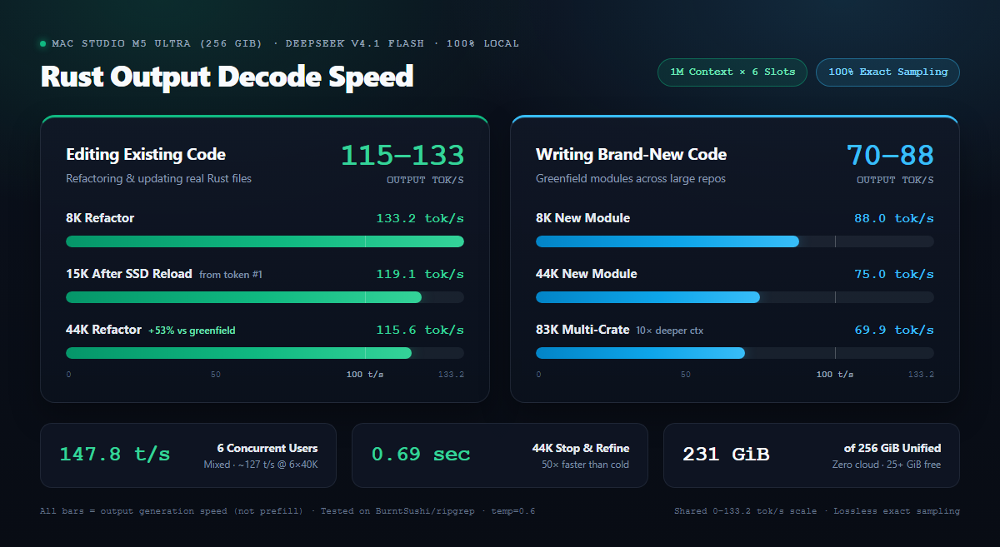

# ds4-m5-ultra — Mac Studio M5 Ultra (256 GiB) Optimizations for `antirez/ds4`

Based on upstream [`antirez/ds4`](https://github.com/antirez/ds4) (DwarfStar, commit `5379c1c`), this branch adds **19 lossless Metal 4, KV-cache, and speculative-decoding optimizations** targeting **DeepSeek V4.1 Flash** on **Apple Mac Studio M5 Ultra** (80-core Metal 4 GPU, 256 GiB unified memory, ~1,150 GB/s bandwidth).

Every optimization is **100% mathematically lossless** under `--mtp-exact-sampling` (exact target distribution preserved via Leviathan et al. residual rejection sampling) and verified for greedy bit-exactness against reference kernels.



---

## Verified Benchmarks (`DeepSeek-V4.1-Flash`, `temp=0.6`, `--mtp-exact-sampling`)

Tested live on a single **Mac Studio M5 Ultra (256 GiB)** with **`1,048,576 × 6` concurrent resident slots** (`--ctx 1048576 --batched-session 6 --dspark --mtp-exact-sampling --dspark-confidence 0.4 --vision ...`) against real Rust source files from [`BurntSushi/ripgrep`](https://github.com/BurntSushi/ripgrep):

### Single-User Output Decode (Generation Speed — Not Prefill)

| Workload | Context Depth | Output Decode Speed | Notes |
| :--- | :---: | :---: | :--- |
| **8K Rust Refactor / Edit** | 7,956 tok | **133.2 tok/s** | 535 ms TTFT · 99.5% live KV hit · DSpark + 6-gram PLD |
| **Short Rust API / Struct** *(Axum / Serde / Tokio)* | <1K tok | **110–120.5 tok/s** | Pure DSpark neural draft |
| **Cold-RAM Disk Reload (Token #1)** | 14,822 tok | **119.1 tok/s** | 7.0 ms `A44` SSD load · warm DSpark ring restored |
| **44K Rust Refactor / Edit** *(18 `.rs` files)* | 43,990 tok | **115.6 tok/s** | 639 ms TTFT · 99.9% KV hit (**+53%** vs. greenfield at 44K) |
| **44K Stop + Refine (`low` thinking)** | 44,009 tok | **88.4 tok/s** | **0.69 s** TTFT vs. **34.9 s** cold prefill (**50× faster**) |
| **8K Brand-New Rust Module** *(9 `.rs` files)* | 7,424 tok | **79.8–88.0 tok/s** | Cold prefill 1,142–1,165 tok/s |
| **44K Brand-New Rust Module** *(18 `.rs` files)* | 43,438 tok | **75.0 tok/s** | Cold prefill 1,245 tok/s · bit-exact BF16 indexer |
| **83K Multi-Crate New Code / Prose** | 82,263 tok | **69.9 / 65.1 tok/s** | 716 ms warm follow-up TTFT · sparse top-2048 blocks |

### Multi-User Concurrent Output Decode (`1,048,576` Context per Slot)

| Concurrency (`temp=0.6`, exact sampling) | Per-User Decode | Combined Throughput | Notes |
| :--- | :---: | :---: | :--- |
| **`c=2` Non-Code Prose** *(DSpark exact batch)* | **48.1–61.0 tok/s** | **96.5–98.6 tok/s** | **+10–13%** agg / up to **+39%** stream vs. plain `c=2` |
| **`c=2` 8K Rust Editing** *(DSpark + 6-gram PLD)* | **47.4–65.2 tok/s** | **96.7 tok/s** | **+26.3%** agg vs. plain `c=2` |
| **`c=6` Mixed General Prompts** *(bench panel)* | **24.2–25.0 tok/s** | **144.1–147.8 tok/s** | 0% regression vs. plain `c=6` |
| **`c=6` × 6–8K Rust** *(6 distinct crates, 36.6K live)* | **22.9–23.0 tok/s** | **~137–138 tok/s** | Steady-state 6-way batched decode |
| **`c=6` × 40K Rust** *(239.3K total live KV tokens!)* | **20.5–21.1 tok/s** | **~126–127 tok/s** | Only −14% vs. empty prompts across 240K live ctx |

### Memory & Storage Footprint (`1M × 6` Resident)

- **Unified RAM:** `230.6 GiB` loaded / `232.7 GiB` peak (`200.9 GiB` idle) out of `256 GiB` → **25+ GiB free**, `< 5 MiB` swap.
- **6 × 1M Context Buffers:** `31.45 GiB` total (`3.13 GiB`/slot + shared `12.51 GiB` prefill workspace; **−3.75 GiB** saved by BF16 `index_cache`).
- **Disk KV Format (`A44`):** `3,192 B/tok` (**−50%** vs. legacy `A41`), ~16M tokens in a 50 GiB disk budget, 100% backward-compatible with `A41`/`A42`/`A43`.

---

## Complete Optimization Breakdown (19 Commits on `antirez/ds4` `5379c1c`)

### Phase 1 — Lossless Metal 4 Kernels & Fast Exact Sampling (`5cb84c4` → `73ae426`)
- **Zero-shmem 1-SG multi-row decode kernels (`M=2..8`):** Q8_0 1-SG-per-2-rows (`dense`, `attn_out_low`, `lm_head`), F16 1-SG-per-row (`engram`, `q_a`, `kv_a`, `indexer`, `DSpark`), and fused Q8_0 shared expert `gate+up+SwiGLU+BF16`.
- **Bit-exact narrowed weights:** Narrow BF16 router (`M=1..8`, 150 MiB), fused BF16 `K=256` DSpark `markov_w2` (63 MiB), bit-exact E4M3 `engram_kv` (2/2) + `indexer_q_b` (8/8) with 8B/lane BF16-fused loads, and untracked resident Metal views.
- **Prefill & long-context kernels:** Single-GPU MXFP4 packed Metal 4 TensorOps MPP + `m32n128` for L30–39 prefill, short-prefill row batching (`2..63`), bit-exact FP16 compressed KV + Metal ARC autorelease pool leak fix, long-context `rows4` indexer scorer gated at `n_rows > 4096` (M5 Ultra empirical crossover) + GPU candidate-block scorer + shuffle top-k.
- **Fast lossless exact sampling:** Deferred residual-sampled correction token to next DSpark cycle (eliminates redundant 1-token target pass), NEON top-p/cutoff + sparse probability support, CPU confidence early-exit + zero-copy Markov logits, and lossless 59.2% DSpark draft vocabulary pruning (Latin + math + code + special tokens; full 129,280 target verification).

### Phase 2 — Smart Chat / Coding-Agent KV Cache (`4f75ef8`)
- **10 tiered in-RAM anchors per slot** (~0.1 ms bit-exact rewind for Stop, Regenerate, Edit, and Fork).
- **Cancel preservation:** Fixed DSpark cancellation wiping live sessions (`-DS4_SESSION_SYNC_INTERRUPTED`) and preserved KV + disk checkpoints across mid-thinking, mid-answer, and mid-prefill Stops.
- **Agent / tool-turn live hits:** V4.1 stripped-`<think>` matching, non-hijacking slot routing, single-pass direct writes, proactive ancestor pruning, and compact lossless `A43` disk format (`3,192 B/tok`, 50% smaller).

### Phase 3 — Native `1,048,576 × 6` Context Unlock on 256 GiB (`e0edb51`)
- Updated `ds41_memory_admit_for_host()` to honor explicit macOS `iogpu.wired_limit_mb` sysctl overrides above the default `7/8` RAM heuristic while enforcing a hard **16 GiB OS memory floor**.
- Paired with a persistent `LaunchDaemon` setting `iogpu.wired_limit_mb=241664` (`236 GiB` Metal wired limit, leaving `20 GiB` reserved for macOS).

### Phase 4 — Decode Turbo (`f3cc4e3` → `ed5c5b9`)
- **Bit-exact BF16 `index_cache` in GPU RAM:** `ushort4` 8-byte vectorized indexer loads and direct BF16 key reads in `kernel_dsv41_indexer_scores_packed`, saving `3.75 GiB` GPU RAM across 6 × 1M slots with zero-copy `A43`/`A44` I/O.
- **Warm 128-row DSpark feature ring in anchors & `A44` disk cache:** Eliminates the 128-token DSpark cold-start after disk reloads, Stops, Edits, or Forks (verified `119.1 tok/s` from Token #1 after a `7.0 ms` SSD load).
- **Lossless 6-gram Prompt-Lookup (PLD) + DSpark hybrid drafting:** Widened `DS41_VERIFY_ROWS` from `6 → 8` (aligned to fast 8-row Metal 4 kernels), incremental 65,536-bucket 3-gram index (`< 0.01 ms` CPU), 6-gram pure-PLD fast path (4-gram when DSpark is sleeping) + 4-gram hybrid tail extension after 5/5 DSpark, mathematically exact point-mass residual rejection sampling, adaptive miss cooldown, and smart 4-token DSpark backoff with instant wakeup on `</think>`, ```` ``` ````, `{`, `}`, `;`, `:`.
- **Lossless `c=2` exact-sampling batched speculation (`ed5c5b9`):** Extended `ds41_sessions_speculate` with per-session `--mtp-exact-sampling` and selective 6-gram PLD inside the fast 8-row Metal 4 budget — boosting 2-user decode by **+13% to +26%** on both non-code prose and Rust edits with **0% regression** at `c=3..6`.

---

## Quick Start on Mac Studio M5 Ultra (256 GiB)

### 1. Build
```bash
make -j8 ds4-server
```

*(Optional unit tests — run while no `ds4-server` is holding the GPU lock):*
```bash
make test-mxfp4-metal
./tests/test_sampling
./tests/test_session_state
```

### 2. Exact Software & Model Requirements (for 1:1 Performance)
- **macOS & Toolchain:** **macOS 27+** (Metal 4 `mpp::tensor_ops` / NAX required — tested on macOS 27.0.1, Apple clang 21.0.0) on AC power (`lowpowermode=0`, `sleep=0`).
- **No hidden environment variables:** Every optimization is enabled by default in `ds4-server` (zero `DS4_*` or `MTL_*` env vars required).
- **Exact GGUF files in `gguf/`:**
  1. **Main model (`-m`):**
     - *Benchmarked mixed quant (`183.4 GiB` resident, `372 GB` on disk incl. SSD Engram tables):* `gguf/DeepSeek-V4.1-Flash-1017-Q2-L30-39-MXFP4.gguf` — layers 0–29 in `IQ2_XXS`/`Q2_K` + layers 30–39 in `MXFP4`, spliced via [`gguf-tools/mixed/splice_mixed_expert_layers_gguf.py`](gguf-tools/mixed/splice_mixed_expert_layers_gguf.py) (from `deepseek41_quantize.py`).
     - *Stock alternative:* `./download_model.sh ds41f-q2` downloads `gguf/DeepSeek-V4.1-Flash-1017-IQ2_XXS-Q2_K-imatrix.gguf` (all 40 layers in Q2 — uses less RAM and decodes slightly faster).
  2. **DSpark drafter (`--mtp-model`, `8.0 GB`):** `gguf/DeepSeek-V4.1-Flash-1017-DSpark.gguf` — extracted losslessly from the DeepSeek-V4.1-Flash checkpoint via [`gguf-tools/deepseek41_dspark.py`](gguf-tools/deepseek41_dspark.py).
  3. **Vision encoder (`--vision`, `926 MB`, optional):** `./download_model.sh ds41f-vision` → `gguf/DeepSeek-V4.1-Flash-Vision.gguf`.

### 3. Unlock `1M × 6` Wired Limit & Install `launchd` Services (256 GiB Mac Studio)
Sanitized templates live in [`deploy/macos-256gb/`](deploy/macos-256gb/):
- [`deploy/macos-256gb/local.ds4.iogpu-wired-limit.plist`](deploy/macos-256gb/local.ds4.iogpu-wired-limit.plist) — sets **both** `iogpu.wired_limit_mb=241664` (`236 GiB` wired cap, `20 GiB` OS floor) **and** `iogpu.disable_wired_collector=1` (prevents macOS IOGPU from reclaiming resident Metal buffers near 230 GiB) at boot.
- [`deploy/macos-256gb/local.ds4.server.plist`](deploy/macos-256gb/local.ds4.server.plist) — production `ds4-server` LaunchAgent (`1M × 6`, `--dspark`, `--mtp-exact-sampling`, 50 GiB `A44` disk KV cache).
- [`deploy/macos-256gb/install.sh`](deploy/macos-256gb/install.sh) — checks for ≥ 256 GiB RAM, substitutes your checkout path & `$HOME`, and bootstraps both services.

```bash
# Review the templates first, then run:
./deploy/macos-256gb/install.sh
```

Or run manually in the foreground (after `sudo sysctl -w iogpu.wired_limit_mb=241664 iogpu.disable_wired_collector=1`):
```bash
./ds4-server \
  -m gguf/DeepSeek-V4.1-Flash-1017-Q2-L30-39-MXFP4.gguf \
  --host 0.0.0.0 --port 8000 \
  --ctx 1048576 --batched-session 6 \
  --dspark --mtp-model gguf/DeepSeek-V4.1-Flash-1017-DSpark.gguf \
  --mtp-exact-sampling --dspark-confidence 0.4 \
  --kv-disk-dir "$HOME/.ds4/server-kv" \
  --kv-disk-space-mb 51200 \
  --kv-cache-cold-max-tokens 262144 \
  --vision gguf/DeepSeek-V4.1-Flash-Vision.gguf
```

> **Note for Macs with < 256 GiB RAM:** Do **not** set `iogpu.wired_limit_mb=241664` on 128 GiB or 192 GiB systems. Keep macOS's default wired limit (or `RAM_MB - 20480`) and lower `--ctx` / `--batched-session` accordingly — all Metal 4 kernels, BF16 `index_cache`, `A44` warm DSpark ring, 6-gram PLD, and `c=2` exact-sampling optimizations work out of the box at every memory tier.

---

## Credits

All core architecture and inference engine foundations belong to Salvatore Sanfilippo ([`antirez/ds4`](https://github.com/antirez/ds4)) and upstream contributors.
