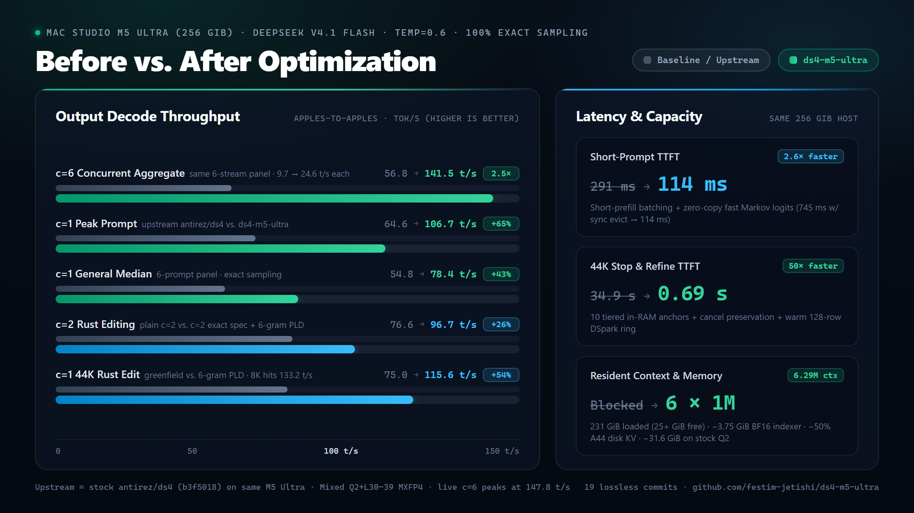
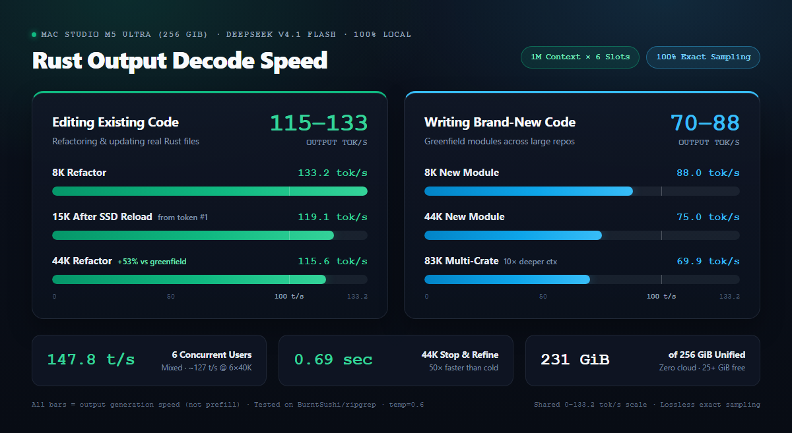

# ds4-m5-ultra

Lossless Metal 4, KV-cache, and speculative-decoding optimizations for [`antirez/ds4`](https://github.com/antirez/ds4) (DwarfStar, based on `5379c1c`), tuned for **DeepSeek V4.1 Flash** on **Apple Mac Studio M5 Ultra (80-core GPU, 256 GiB)**.

Runs **6 concurrent 1,048,576-token resident context slots** alongside the model, DSpark drafter, and vision encoder on a single machine — with **100% exact sampling** (`--mtp-exact-sampling`) and **25+ GiB unified RAM free** (or **31.6 GiB less RAM / ~57 GiB free** on stock pure Q2).



## Measured Output Decode (`DeepSeek-V4.1-Flash`, `temp=0.6`, exact sampling)

All numbers below are live **output generation** speeds (not prefill) on a single 256 GiB M5 Ultra running the heavier mixed `Q2 + L30–39 MXFP4` quant (`183.4 GiB` resident weights, `1M × 6` live slots, real Rust repos from `BurntSushi/ripgrep`). Stock pure `ds41f-q2` uses **31.6 GiB less RAM** and decodes slightly faster.

| Scenario | Context | Output Decode | vs. Baseline / Notes |
| :--- | :---: | :---: | :--- |
| **Rust edit / refactor** | 8K / 44K | **133.2 / 115.6 tok/s** | `+54%` vs. greenfield · `535–639 ms` TTFT · DSpark + 6-gram PLD |
| **Brand-new Rust module** | 8K / 44K / 83K | **88.0 / 75.0 / 69.9 tok/s** | Cold prefill `1,142–1,245 tok/s` |
| **Cold-RAM SSD reload** | 15K | **119.1 tok/s** | `7.0 ms` `A44` load · warm DSpark ring from Token #1 |
| **Stop & Refine** | 44K | **88.4 tok/s** | **`0.69 s`** TTFT vs. `34.9 s` cold (**50×**) |
| **`c=2` concurrent** *(prose / Rust edit)* | 1M / slot | **96.5–98.6 tok/s** | **+13% to +26.3%** vs. plain `c=2` (`76.6 → 96.7`) |
| **`c=6` concurrent** *(panel / 6×40K Rust)* | up to 240K live | **141.5–147.8 / ~127 tok/s** | **2.5×** vs. upstream `56.8 t/s` · only `−14%` @ 240K live |



## Memory Footprint (`1,048,576 × 6` Resident on 256 GiB)

- **Mixed `Q2 + L30–39 MXFP4` + resident vision (`926 MiB`) + DSpark (`8.0 GB`):** `230.6 GiB` loaded (`200.9 GiB` idle) → **25+ GiB free**, `< 5 MiB` swap.
- **Stock pure `Q2` (`ds41f-q2`):** `151.8 GiB` weights (**31.6 GiB less resident RAM**, `~199 GiB` total) → **~57 GiB free**.
- **All 6 × 1M context slots:** `31.45 GiB` total (`3.13 GiB`/slot + shared workspace), including **−3.75 GiB** saved via bit-exact BF16 `index_cache`.
- **Disk KV cache (`A44`):** `3,192 B/tok` (**−50%** vs. legacy `A41`), fitting ~16M cached tokens in 50 GiB.

## What's Inside (19 Commits on `antirez/ds4`)

- **Metal 4 decode & prefill kernels:** Zero-shmem 1-SG multi-row Q8_0 / F16 kernels (`M=2..8`), fused shared-expert SwiGLU, bit-exact narrow BF16 router + E4M3 `engram_kv` / `indexer_q_b`, single-GPU MXFP4 packed TensorOps MPP prefill, bit-exact BF16 `index_cache`, and empirically gated `rows4` long-context indexer.
- **Lossless DSpark + 6-gram PLD speculation:** 8-row verify budget, incremental `< 0.01 ms` 3-gram index with 6-gram PLD fast path + hybrid tail, 59.2% pruned DSpark draft vocab (full 129,280 exact verification), deferred correction token, smart backoff with code-token instant wakeup, and **`c=2` exact-sampling batched speculation** (`0%` regression at `c=3..6`).
- **Smart KV, vision & instant rewind (`A44`):** 10 tiered in-RAM anchors per slot (`~0.1 ms` Stop / Edit / Fork rewind) with **vision-fingerprint matching** for multimodal chats, preserved sessions across cancellation, warm 128-row DSpark ring persisted in anchors and disk cache, and `iogpu.wired_limit_mb` admission honoring a 16 GiB OS floor.

## Quick Start (macOS 27+ / Metal 4)

```bash
git clone https://github.com/festim-jetishi/ds4-m5-ultra.git
cd ds4-m5-ultra
make -j8 ds4-server

# 1. Pure Q2 base (151.8 GiB RAM — 31.6 GiB leaner than mixed) + separate 926 MiB vision encoder
./download_model.sh ds41f-q2
./download_model.sh ds41f-vision

# 2. DSpark drafter (downloads only 7.4 GiB -> builds 8.0 GB DSpark GGUF)
./tools/m5-ultra/build_dspark.sh

# 3. (Optional) Exact L30-39 MXFP4 splice (HTTP-Range fetches only 67.2 GiB)
./tools/m5-ultra/build_mixed_l30_39_mxfp4.sh
```

On a **256 GiB Mac Studio**, install the persistent wired-memory + `ds4-server` `launchd` services (sets `iogpu.wired_limit_mb=241664` and `iogpu.disable_wired_collector=1`):

```bash
./deploy/macos-256gb/install.sh
```

> **More documentation:** Full 19-commit engineering notes, Hugging Face source links, manual launch command, and `< 256 GiB` notes are in **[`M5_ULTRA.md`](M5_ULTRA.md)** and **[`tools/m5-ultra/README.md`](tools/m5-ultra/README.md)**. The original upstream DwarfStar documentation is preserved in **[`UPSTREAM_README.md`](UPSTREAM_README.md)**.

## Credits

All core inference engine architecture, Metal foundations, and GGUF tooling belong to Salvatore Sanfilippo ([`antirez/ds4`](https://github.com/antirez/ds4)) and upstream contributors.
